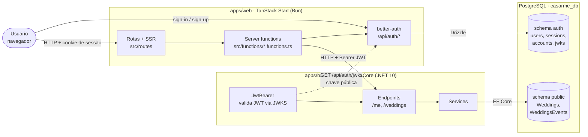
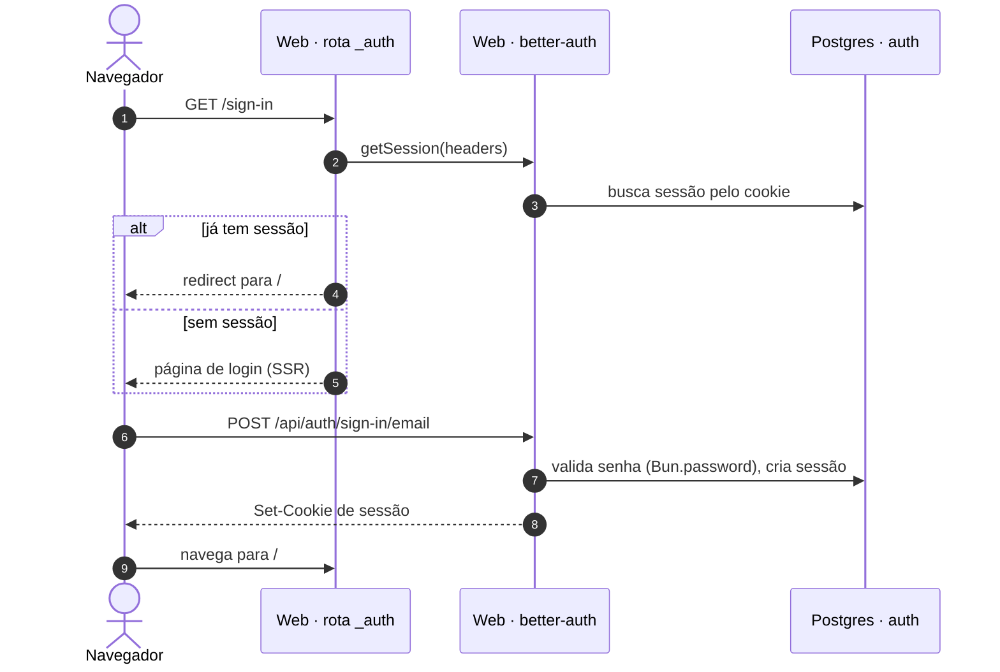
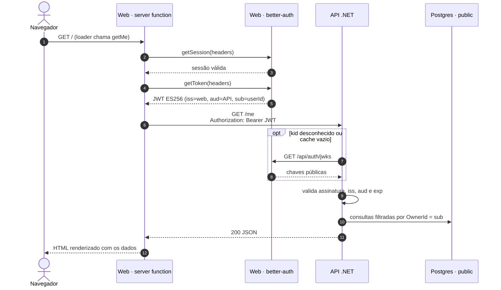
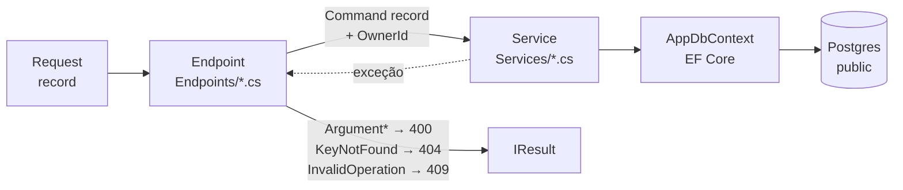

# Arquitetura

Visão macro de como o Casarme funciona de ponta a ponta. Para escopo e regras de negócio, ver [PRD.md](./PRD.md).

## Visão geral

O sistema tem três peças:

- **Web** (`apps/web`): app TanStack Start rodando em Bun. Renderiza as páginas (SSR), é dono da autenticação (better-auth) e é o único cliente da API.
- **API** (`apps/backend`): ASP.NET Core (.NET 10). Concentra o domínio (casamentos, eventos, convidados, RSVP, check-in) e confia nos JWTs emitidos pelo web.
- **PostgreSQL**: um único banco (`casarme_db`), dividido por schema entre os dois apps.

Pontos principais:

- **O navegador nunca chama a API .NET diretamente.** Toda chamada sai de uma server function do web, que roda no servidor. Por isso a API não tem CORS, e o JWT nunca chega ao navegador.
- **Duas credenciais, dois papéis.** Entre o navegador e o web vale o cookie de sessão do better-auth. Entre o web e a API vale um JWT de curta duração, gerado a cada chamada.
- **Cada app é dono do seu schema.** O web migra o schema `auth` com Drizzle (`apps/web/drizzle/`). A API migra o `public` com EF Core (`Data/Migrations/`). Nenhum dos dois lê as tabelas do outro: a API só conhece o usuário pelo `sub` do JWT, que vira o `OwnerId` dos registros.

## Autenticação

### Login (navegador ↔ web)

### Chamada à API (web ↔ API)

Detalhes que importam:

- **ES256, não EdDSA.** O better-auth assina com EdDSA por padrão, mas o `Microsoft.IdentityModel` não verifica EdDSA. Por isso o plugin `jwt` está configurado com `keyPairConfig: { alg: "ES256" }`.
- **Sem discovery OIDC.** O better-auth expõe só o JWKS, sem `/.well-known/openid-configuration`. A API carrega as chaves direto dele (`Common/JwksRetriever.cs`, URL em `Authentication:JwksUrl`), guarda em cache e busca de novo quando aparece um `kid` desconhecido. Assim uma rotação de chave funciona sem reiniciar a API.
- **Multi-tenancy por dono.** Cada endpoint protegido converte o `sub` em `OwnerId` (`ICurrentUser`), e os services filtram toda consulta por ele. Não existe RBAC; o PRD deixa isso fora do MVP.

## Camadas da API

Não existe camada de repositório: os services usam o `AppDbContext` direto. Os erros de domínio sobem como exceções, e o endpoint converte cada tipo em um status HTTP.

## Ambientes

| | Desenvolvimento | Produção |
|---|---|---|
| Web | `http://localhost:3000` | `https://casarme.app` |
| API | `http://localhost:5264` | — |
| Issuer do JWT | `http://localhost:3000` | `https://casarme.app` |
| Audience aceito pela API | `http://localhost:5264`, `https://localhost:7222` | `api.casarme.app` |
| JWKS | `http://localhost:3000/api/auth/jwks` | `https://casarme.app/api/auth/jwks` |
| Banco | Postgres 18 via `docker-compose.yaml` | — |

## Pontos em aberto

- O audience do JWT está fixo como `http://localhost:5264` em `apps/web/src/lib/auth/server.ts`. Em produção a API espera `api.casarme.app`, então esse valor precisa vir de variável de ambiente antes do deploy.
- A URL da API em produção e a infraestrutura de deploy ainda não estão definidas.
- O fluxo de convidado (RSVP por link) e a recepção (check-in por QR code com PIN) do PRD ainda não existem. Os dois vão precisar de acesso sem conta, ou seja, um caminho de autenticação diferente do JWT do casal.
