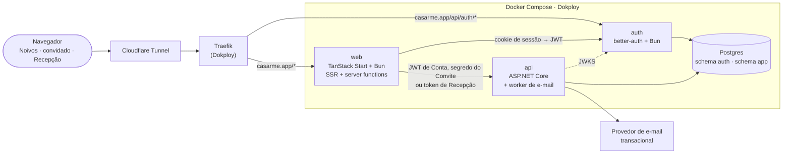

# Arquitetura

Visão geral de como o Casarme é montado e organizado. As decisões que custam caro para reverter estão nos [ADRs](./adr/); o modelo de dados está em [modelo-de-dominio.md](./modelo-de-dominio.md).

## Peças



- **`web`**: um único frontend [TanStack Start](https://tanstack.com/start) rodando em Bun, com SSR. Ele atende os três públicos, separados por área de rotas:
  - Noivos: a área logada.
  - Convidado: `/c/{segredo}`.
  - Recepção: `/{identificador}/recepcao`, que é uma PWA.

  O navegador fala só com o `web`. As *server functions* chamam a `api` e o `auth` pela rede interna, então não há CORS e nenhum token chega ao navegador ([ADR 0007](./adr/0007-frontend-full-stack-como-bff.md)).
- **`auth`**: serviço [better-auth](https://www.better-auth.com) em Bun. Cuida **só das Contas**: login com Google, sessão e emissão do JWT que a `api` aceita.
- **`api`**: ASP.NET Core, *resource server* do domínio ([ADR 0005](./adr/0005-frontend-api-e-auth-separados.md)). Não fica exposta à internet. Aceita três credenciais:
  - o JWT de Conta, validado pelo JWKS do `auth`;
  - o segredo do Convite;
  - o token de Recepção, que ela mesma emite ao receber o PIN ([ADR 0006](./adr/0006-api-autentica-convidado-e-recepcao.md)).
- **Postgres**: uma instância com dois schemas. O `auth` é dono do schema `auth`, e a `api` é dona do schema do domínio. Nenhum serviço lê as tabelas do outro: a `api` conhece a Conta só pelo `sub` e copia nome e e-mail do JWT para o Noivo.

## Domínio e roteamento

- Um domínio só, `casarme.app`. O Traefik do Dokploy manda `/api/auth/*` para o `auth` e todo o resto para o `web`.
- Como a Recepção fica em `/{identificador}/recepcao`, os Identificadores de Casamento não podem coincidir com caminhos do sistema, como `api`, `c` e as rotas dos Noivos. Essa lista de identificadores reservados é mantida no código e verificada ao cadastrar ou editar o Identificador.

## Monorepo

```
apps/
  web/          TanStack Start (Noivos, convidado e Recepção)
  api/          ASP.NET Core (solution .NET, com package.json fino para o Turborepo)
  auth/         better-auth
packages/
  api-client/   tipos e cliente gerados do OpenAPI da api
docs/           PRD, glossário, ADRs, modelo de domínio e esta página
```

- **Bun** é o runtime e o gerenciador de pacotes do lado TypeScript, com a versão fixada no repositório (`packageManager`). O **Turborepo** orquestra as tarefas.
- **Contrato entre `api` e `web`:**
  1. A `api` gera o OpenAPI a partir do próprio código.
  2. O `packages/api-client` gera tipos e um cliente `fetch` tipado com `@hey-api/openapi-ts`.
  3. O Turborepo conhece a cadeia `api` → `openapi.json` → `api-client` → `web`.
  4. O CI falha se o cliente gerado estiver desatualizado.

## Organização da `api`

- Um projeto só, organizado por módulo do domínio (*vertical slices*): `Casamentos/`, `Convidados/`, `Convites/`, `Recepcao/` e `Envio/`. Cada módulo tem os seus endpoints, casos de uso e entidades.
- As regras de negócio ficam nas entidades. O EF Core é usado direto nos casos de uso, sem camada de repositório.
- **Envio de e-mail:**
  - A requisição de envio só grava um pedido numa tabela, na mesma transação que marca os Convites como enviados.
  - Um *hosted service* (serviço em segundo plano) da própria `api` lê os pedidos e chama o provedor de e-mail transacional, com novas tentativas em caso de falha.
  - O WhatsApp não passa por aqui: é um link `wa.me` aberto pelo Noivo ([ADR 0002](./adr/0002-whatsapp-via-wa-me.md)).

## Login

- Só Google no MVP. Por isso o e-mail da Conta chega sempre verificado, e o `auth` não guarda senhas nem envia e-mails. Login por *magic link* fica como evolução, ligando um plugin do better-auth.

## Recepção

- A PWA é **só online** no MVP. A tela de Check-in é leve (uma chamada pequena por leitura) e mostra claramente se registrou ou não. O modo offline com sincronização fica para quando os casamentos reais mostrarem que a falta de sinal é um problema.

## Banco e migrações

- Cada serviço tem um container de migração que roda e termina antes do serviço subir (`api-migrate` com um *migration bundle* do EF Core e `auth-migrate` com as migrações do Drizzle, geradas a partir do schema do better-auth). Os serviços nunca migram o banco ao iniciar.

## Ambientes

- **Desenvolvimento:**
  - Só o Postgres roda no Compose. O `turbo dev` sobe o `web`, o `auth` e a `api` direto na máquina, com recarregamento automático.
  - O servidor de desenvolvimento do `web` repassa `/api/auth/*` para o `auth`, reproduzindo a mesma origem da produção.
  - Um *profile* `full` do Compose sobe tudo em container, como em produção.
- **Hospedagem** ([ADR 0008](./adr/0008-containers-auto-hospedados.md)):
  - Tudo em containers Docker, gerenciados pelo Dokploy, primeiro no servidor de casa e depois numa VPS.
  - A exposição à internet é feita pelo Cloudflare Tunnel, sem porta aberta e sem IP da casa exposto.
  - A migração para a VPS precisa acontecer antes do primeiro casamento real.

## Testes

- **Regras de domínio**: testes de unidade nas entidades da `api`, sem banco.
- **Casos de uso da `api`**: testes de integração contra Postgres de verdade, com Testcontainers, nunca com banco em memória.
- **`web`**: `bun test` para a lógica pura, e poucos testes de ponta a ponta com Playwright, só nos fluxos críticos (RSVP pelo link e Check-in pelo QR code e pelo nome).

## CI e deploy

- **GitHub Actions, em cada PR:** checagem de tipos, testes, verificação do `api-client` gerado e build das imagens.
- **No merge para `main`:** as imagens são publicadas no GHCR com a tag do commit.
- **Deploy:** o Dokploy atualiza os containers automaticamente quando chega uma imagem nova. As migrações rodam antes dos serviços. Voltar uma versão é subir a tag anterior.

## Em aberto

### Backup do Postgres

Ainda não decidido. Opções levantadas:

- **`pg_dump` diário enviado para fora de casa** (Backblaze B2 ou Cloudflare R2), guardando 30 dias, com teste de restauração periódico. Era a recomendação: um dia de perda máxima é aceitável antes do primeiro casamento real, desde que o backup saia de casa. O Dokploy já tem backup agendado de Postgres para storage S3, o que pode cumprir esse papel.
- **Backup contínuo** (*point-in-time recovery* com WAL-G ou pgBackRest): permite voltar para qualquer minuto, mas é mais complexo. Vale reavaliar na migração para a VPS.
- **Snapshot do disco do servidor**: fica na mesma casa que o original, então não protege contra perder a máquina.

### Observabilidade

Ainda não decidido. Opções levantadas:

- **O mínimo**: era a recomendação. Pode ser ligado depois sem reescrever nada.
  - Logs estruturados em JSON na saída padrão (Serilog na `api`, logger JSON no `web` e no `auth`), visíveis no Dokploy.
  - Sentry gratuito nos três serviços, para receber cada erro com *stack trace* e alerta por e-mail.
  - Um verificador de disponibilidade **externo à casa** (por exemplo UptimeRobot) chamando o health dos serviços públicos (`/api/health` no `web`, `/health` nos demais).
- **Observabilidade completa** (OpenTelemetry + Grafana, Loki e Tempo, auto-hospedados): métricas, *traces* e logs centralizados, mas pesada de operar sozinho num MVP.
- **Só os logs do Dokploy**: o mínimo possível, sem alerta nenhum.
