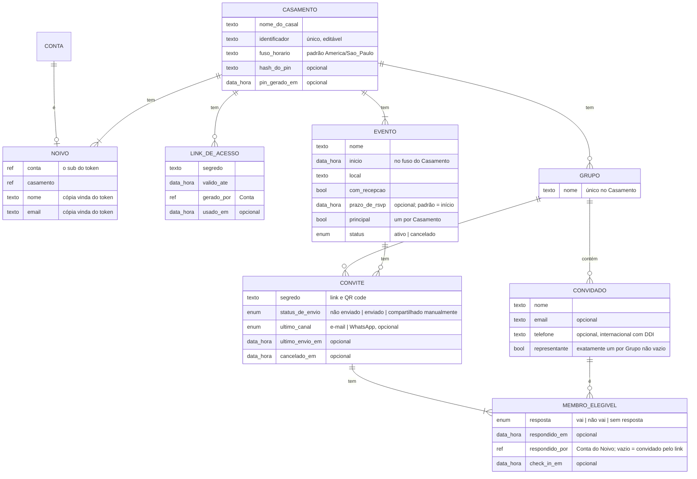

# Modelo de Domínio

Modelo conceitual dos dados do Casarme. Os termos seguem o [GLOSSARY.md](./GLOSSARY.md), e o escopo e as regras de negócio estão no [PRD.md](./PRD.md). Este documento não fixa tecnologia, tipos de coluna ou nomes no código.

## Entidades

Todas as entidades guardam também a data de criação e a da última atualização (NFR-03).

## Casamento e acesso

- O **Casamento** é a raiz: todo registro do domínio pertence, direta ou indiretamente, a um único Casamento, e nada é compartilhado entre Casamentos.
- A **Conta** fica fora do domínio. Ela se liga ao Casamento por um **Noivo** ([ADR 0004](./adr/0004-noivo-como-vinculo-e-link-de-acesso.md)). Uma Conta é Noivo de no máximo um Casamento, e todos os Noivos têm o mesmo poder.
- Qualquer Noivo pode sair do Casamento ou remover outro Noivo, mas o último Noivo não pode sair. Registros que apontam para a Conta, como `respondido_por`, continuam válidos depois que ela deixa de ser Noivo.
- O **Link de acesso** é de uso único e tem validade. Ele só vale enquanto não foi usado e não venceu.
- O **Identificador do Casamento** pode ser editado. Ele aparece só nas telas dos Noivos e no endereço da Recepção (`/{identificador}/recepcao`), nunca nos links dos Convites.

## Fuso horário

- O fuso é do **Casamento**, e todos os Eventos dele o usam. Toda regra que depende de "agora" (Prazo de RSVP, Convite expirado, "Eventos de hoje" na Recepção) obtém o fuso do Evento por **um único lugar**, que hoje devolve o fuso do Casamento.
- Para passar a ter um fuso por Evento, basta acrescentar o fuso ao Evento, copiar o do Casamento e mudar esse único lugar.

## Grupos e Convidados

- Todo Convidado pertence a exatamente um **Grupo**. Se for cadastrado sem Grupo, o sistema cria um Grupo de uma pessoa só, com o nome dele.
- Todo Grupo com pelo menos um Convidado tem exatamente um representante. O primeiro que entra vira representante; se o representante sair, o Convidado mais antigo que ficou assume. Grupo vazio não tem representante.
- O contato (e-mail e telefone) é do Convidado, nunca do Grupo.
- Quando um Convidado muda de Grupo, ele deixa de ser Membro elegível nos Convites do Grupo de origem (BR-25).

## Convites e Membros elegíveis

- O **Convite** é um Grupo × um Evento. Cada Grupo tem no máximo um Convite não cancelado por Evento.
- Cada Convite tem um único segredo, usado no link (`/c/{segredo}`) e no QR code ([ADR 0003](./adr/0003-qr-code-e-o-link-do-convite.md)).
- Convidar de novo um Grupo cujo Convite foi cancelado cria um Convite novo, com segredo novo. Um Convite cancelado nunca é reativado.
- O **Membro elegível** é um Convite × um Convidado, e guarda tudo daquela pessoa naquele Evento: resposta, quem respondeu, quando, e o momento do Check-in. Não há histórico, só a última resposta (BR-14).
- Só o último envio fica guardado no Convite. Não há histórico de envios.

## Valores calculados (não guardados)

- **Representante do Convite:** o representante do Grupo, se for Membro elegível; senão, o primeiro Membro elegível.
- **Status do Convite**, avaliado nesta ordem:
  1. **cancelado**, se tiver data de cancelamento;
  2. **respondido**, se todos os Membros elegíveis tiverem resposta;
  3. **expirado**, se o Prazo de RSVP já passou;
  4. **pendente**, nos demais casos. Um Membro elegível acrescentado depois entra sem resposta, e o Convite volta para pendente sozinho.
- **Status do Check-in do Convite:**
  - **completo**, quando todos os Membros elegíveis que responderam "vai" já entraram;
  - **parcial**, quando entrou ao menos um, mas falta alguém que respondeu "vai".
- **Prazo de RSVP efetivo:** o prazo definido no Evento ou, se não houver, o início do Evento.

## Recepção

- O **PIN de Recepção** é um atributo do Casamento: um PIN ativo por vez, e gerar outro substitui o anterior. O sistema guarda só o hash e mostra o PIN aos Noivos uma única vez, na hora de gerar. Revogar é apagar o PIN.
- O Check-in pode ser feito pela Cerimonialista, com o PIN, ou pelos Noivos, pela própria Conta. O sistema registra só **quando** foi feito, não **quem** fez.

## Apagar vs. cancelar

A regra geral é que só se apaga o que nunca saiu do sistema.

| Entidade | Pode apagar quando | Caso contrário |
|---|---|---|
| Convidado | sempre (a interface avisa se ele já respondeu ou fez Check-in) | — |
| Grupo | estiver vazio | — |
| Convite | nunca foi enviado | cancelar |
| Evento | nenhum Convite dele foi enviado, e não é o Evento principal | cancelar (exceto o Evento principal) |
| Casamento | fora do MVP | — |

- Apagar um Convidado apaga junto os Membros elegíveis dele.
- Um Convite que fica sem nenhum Membro elegível (porque o último foi apagado ou mudou de Grupo) é apagado, se nunca foi enviado, ou cancelado, se já foi (BR-08). A interface avisa antes de confirmar.

## Importação

- A importação não é guardada: o relatório aparece logo depois dela e não é salvo.
- Uma linha cujo nome já existe no **mesmo Grupo** é ignorada e aparece no relatório como "já existia". O nome é comparado ignorando maiúsculas e minúsculas, acentos e espaços extras.

## Fora do modelo no MVP

- Histórico de envios.
- Histórico de respostas do RSVP.
- Registro das importações.
- Vários PINs de Recepção ativos ao mesmo tempo.
- Quem fez cada Check-in.
- Fuso horário por Evento.
- Apagar Casamento.
